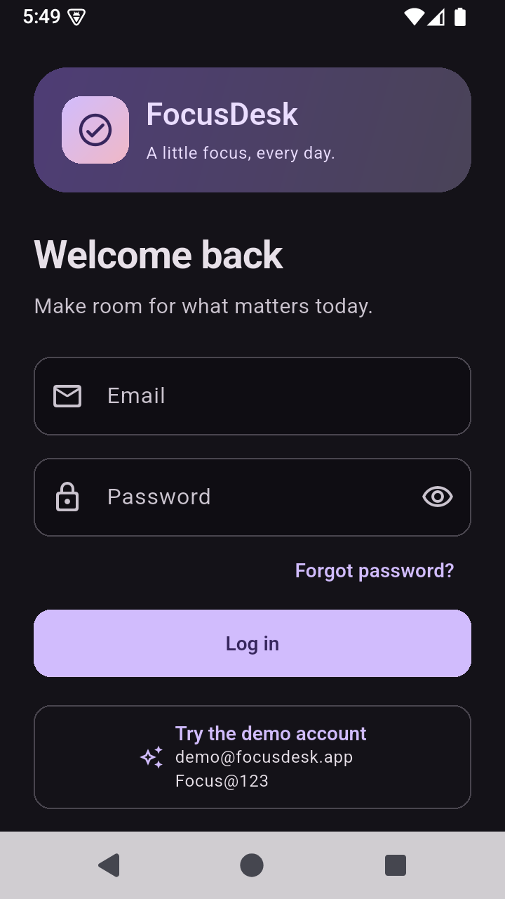
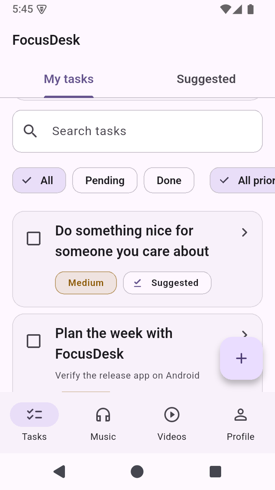
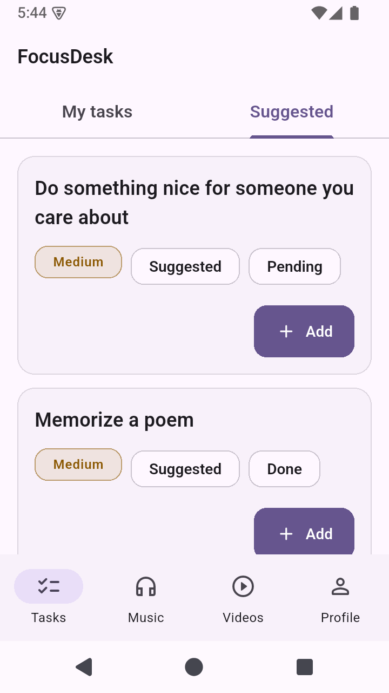
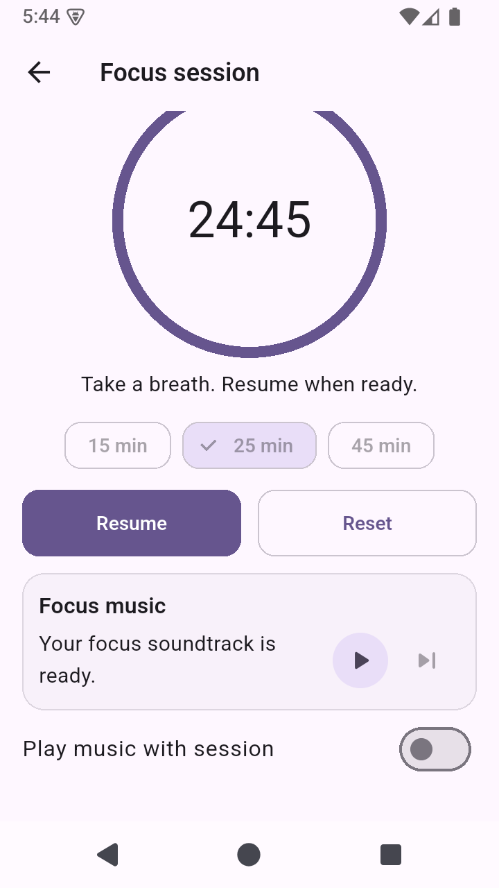
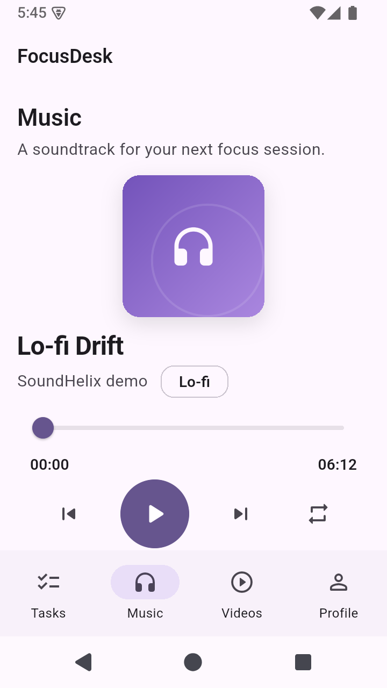
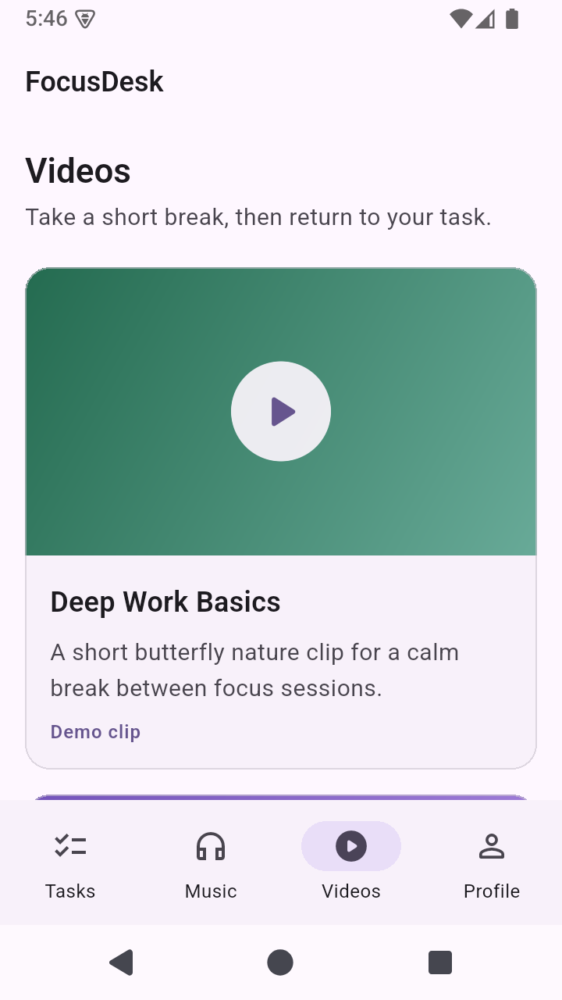
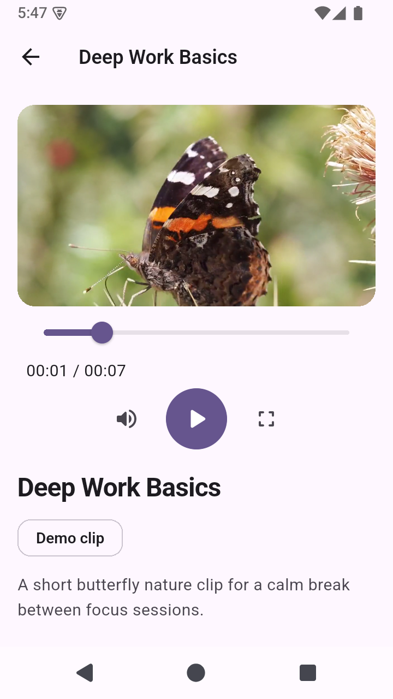
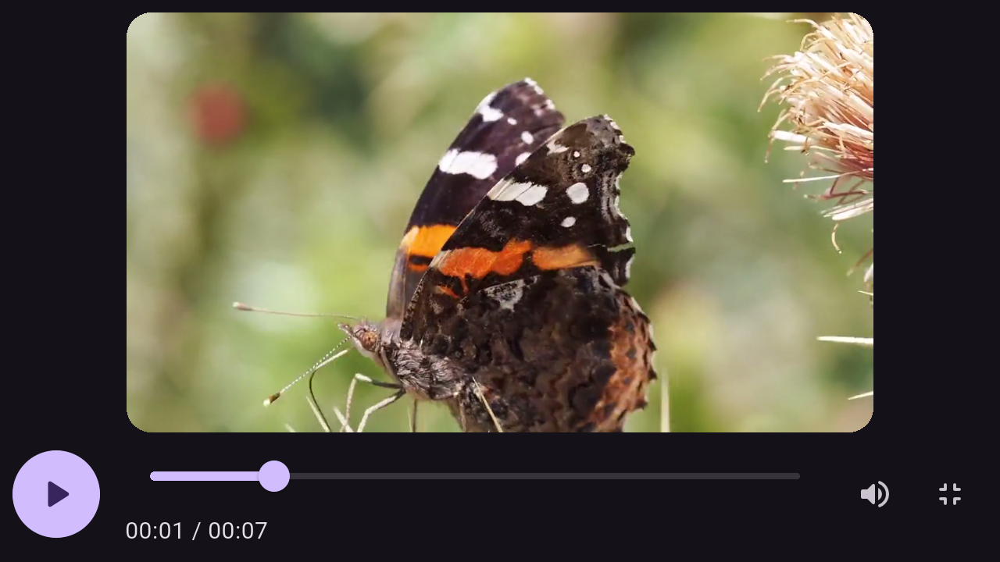
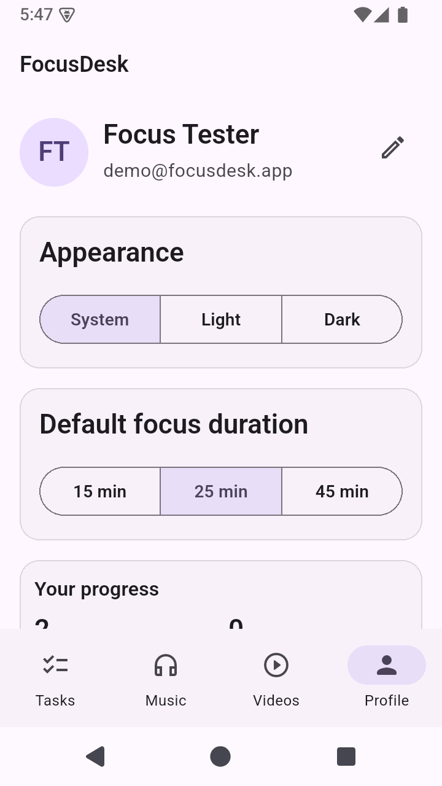

# FocusDesk

**Turn a task into a focus session: choose what matters, start a timer, add a soundtrack, and track your progress.**

FocusDesk is a Flutter Android assignment with local task management, a paginated public API, focus sessions, audio/video playback, and persistent preferences. Material 3 light/dark themes and phone/tablet navigation keep the experience consistent.

## Try the app

Install the verified [review APK](release/focusdesk-release.apk) on Android 7.0/API 24 or later. Internet access is needed for Suggested tasks and remote media; saved tasks, sessions, and settings are local.

| Demo account | Value |
| --- | --- |
| Email | `demo@focusdesk.app` |
| Password | `Focus@123` |
| Name | Demo User |

**Try the demo account** fills the Login fields; press **Log in** to continue. You can also create a local account. Authentication is a demonstration implementation, not a production identity system.

## Features

### Tasks

- Create/edit a title, description, priority, and optional due date; mark tasks done or pending.
- Search titles/descriptions with a 400 ms debounce, combine status/priority filters, and pull to refresh the newest-first local list.
- Read full task details, swipe to delete, and restore the exact snapshot through the six-second Undo action.
- Switch between My Tasks and Suggested. Suggested loads lazily, supports refresh/pagination, and imports with duplicate protection and a Suggested badge.
- Forms/details guard repeated navigation and unsaved edits; loading, empty, filtered-empty, validation, missing-task, and storage-error states have appropriate actions.

### Focus Session

- Start from task details with 15, 25, or 45 minutes; Profile supplies the saved default.
- Use the progress ring/countdown, pause/resume, confirmed Reset, and Stay/Leave confirmation.
- Enable/disable music and control the shared player's play/pause and next track.
- Natural completion saves a completed session and offers to mark the task done. Confirmed early departure saves a partial only after **more than 10 active seconds**; paused time is excluded.
- Failed saves retain the same pending session ID for Retry. Home/Profile show sessions today, focus minutes, tasks completed today, and a day streak.

### Music

- Three tracks with themed artwork, title/artist, selection, play/pause, seek, previous/next, and repeat-all.
- Decoded duration/position, loading/buffering feedback, friendly error/Retry, and Replay playlist after completion.
- One lazy app-scoped player is shared by Music and Focus; tab changes/Focus departure preserve its selection and position.
- Remote failures can recover with the bundled audio sample. Leaving the resumed app lifecycle pauses playback; returning does **not** autoplay.

### Videos

- Two cards, an individual player page, descriptions, and More videos navigation that keeps Back returning to the library.
- Play/pause, seek, elapsed/total time, mute, replay, loading/buffering, and friendly error with a bundled-sample Retry.
- Portrait layout and fullscreen landscape playback share the same controller/position. Exit restores visible system bars and portrait on compact phones; tablets return orientation control to the OS.
- Demo labels/descriptions disclose the butterfly/bee nature footage. Display titles do not make these productivity tutorials.

### Auth

- Session-aware splash, validated login/signup, password visibility, confirmation-password checks, duplicate-email feedback, and persisted local sessions.
- Normalized emails/account names and **unsalted SHA-256 password hashes** are stored in SharedPreferences. This is mock auth, not secure credential storage.
- Logout clears the active session and feature caches, stops an existing player, and replaces the stack with Login; saved tasks/sessions remain.

### Profile

- Edit/persist your name; apply System/Light/Dark live; save the default focus duration.
- Read the shared progress summary and confirm logout or Clear data.
- Clear data removes device-wide tasks/focus sessions while preserving registered accounts, the active login, and theme/duration preferences.

## Screenshots

These unchanged Android emulator captures contain illustrative QA-created records. Those tasks/sessions are **not bundled seed data**. Media names are display aliases and video footage is nature demo content. [Capture notes](docs/screenshots/README.md) describe the source/context.

| Login | Tasks | Suggested |
| --- | --- | --- |
|  |  |  |

| Focus | Music | Videos |
| --- | --- | --- |
|  |  |  |

| Video player | Fullscreen | Profile |
| --- | --- | --- |
|  |  |  |

## Stack and package choices

These are direct constraints from [pubspec.yaml](pubspec.yaml); [pubspec.lock](pubspec.lock) records resolved dependencies.

| Package / SDK | Constraint | Purpose and rationale |
| --- | --- | --- |
| Flutter | SDK | Material 3 UI, layout, navigation, semantics, and platform integration. |
| `flutter_bloc` | `^9.1.1` | Cubits separate operations from rendering; Bloc/Repository providers supply scoped DI without a service locator. |
| `equatable` | `^3.0.0` | Value equality for immutable models/states, selective rebuilds, and test assertions. |
| `dio` | `^5.11.1` | Timeouts, interceptors, and injectable HTTP adapters for Suggested tasks. |
| `hive` | `^2.2.3` | Task/session string boxes with explicit JSON serialization, without generated adapters. |
| `hive_flutter` | `^1.1.0` | Initializes Hive in Flutter's application storage location. |
| `shared_preferences` | `^2.5.6` | Simple local persistence for mock accounts/session, theme, and duration. |
| `just_audio` | `^0.10.6` | Playlist commands and position/duration/index/status streams behind a service boundary. |
| `video_player` | `^2.14.1` | Native network/asset decoding and listener-based playback state. |
| `chewie` | `^1.17.2` | Inline presentation around the native controller; app-owned controls/fullscreen provide consistent behavior. |
| `intl` | `^0.20.3` | Human-readable date formatting. |
| `uuid` | `^4.6.0` | Stable IDs for local users, tasks, and sessions. |
| `crypto` | `^3.0.7` | SHA-256 verification for mock auth; not a production password-hashing scheme. |
| `flutter_test` | SDK, development | Unit/widget, semantics/layout, and integration-style app journey tests. |
| `flutter_lints` | `^6.0.0`, development | Shared static-analysis rules. |
| `bloc_test` | `^10.0.0`, development | Checks Cubit transitions and operation behavior. |
| `mocktail` | `^1.0.5`, development | Controlled dependency mocks and isolated fixtures. |
| `flutter_launcher_icons` | `^0.14.4`, development | Android launcher/adaptive-icon resource generation. |
| `flutter_native_splash` | `^2.4.8`, development | Native launch resources including Android 12 and night variants. |

Python/Pillow support branding regeneration only; they are not app runtime dependencies.

## Architecture

```text
bootstrap(): Hive + prefs -> AppDependencies
                              |
                       FocusDeskApp / providers
                              |
UI / feature view -> Cubit + Equatable state
                              |
                         Repository
                              |
                 +------------+
                 |            |
          Local datasource  Remote datasource
                 |            |
         Hive / preferences  Dio -> DummyJSON

AudioCubit -> AudioRepository (catalog)
           +-> AudioPlayerService -> just_audio

State updates -> BlocBuilder / BlocConsumer -> UI
Static audio/video catalogs supply immutable model lists.
```

`main.dart` awaits [bootstrap.dart](lib/bootstrap.dart): initialize Hive boxes, load preferences, construct repositories, and seed the demo account before the first Flutter frame. Startup failures show friendly Retry.

[app.dart](lib/app.dart) injects repositories with `RepositoryProvider` and Cubits with `BlocProvider`. Business flows follow **UI → Cubit → Repository → Datasource**. Audio uses an injectable service; the video widget owns native controllers/local presentation state directly. Static catalogs need no datasource.

| Responsibility | State / dependency flow |
| --- | --- |
| Auth | `AuthCubit` → `AuthRepository` → `AuthLocalDatasource` / `PrefsService`. |
| Tasks | `TaskCubit` → `TaskRepository` → `TaskLocalDatasource` / `HiveService`. |
| Suggested | `SuggestedCubit` → `SuggestedRepository` → `SuggestedRemoteDatasource` / Dio; imports use shared `TaskCubit`. |
| Music | `AudioCubit` → `AudioRepository` catalog + `AudioPlayerService`; `AudioLifecycleBinding` owns one lazy player. |
| Focus | Each `FocusScreen` owns `TimerCubit` → shared `FocusRepository`; clock/ticker injection enables deterministic tests. |
| Stats | Shared `StatsCubit` → `FocusRepository`, which also reads the shared task repository. |
| Profile/settings | `ProfileCubit` → `ProfileRepository`; `ThemeCubit`/`SettingsCubit` persist through `PrefsService`. |
| Video/home | `FocusVideoPlayer` owns controllers and local state; pure `VideoViewState` mapping. `HomeShell` owns tab selection; neither needs a business Cubit. |

Business Cubits use immutable Equatable states, feature-specific statuses, and guards against repeated work, stale async results, and emissions after close. Repository queues serialize mutations; relevant UI controls disable while work is busy.

[AppRouter](lib/core/router/app_router.dart) validates named-route task/video arguments and shows a safe Return home fallback. Task-title Heroes, bounded state transitions, and list motion honor reduced-motion settings. Home's `IndexedStack` keeps tabs mounted and preserves their state; Music decoding and Suggested fetching start lazily on activation. Navigation switches to a rail at 720 logical pixels.

### Folder structure

```text
lib/
  main.dart, bootstrap.dart, app.dart
  core/
    constants/          copy, keys, URLs, timing values
    theme/              colors, typography, Material themes/system bars
    router/             named routes and argument checks
    utils/              validation, dates, debounce
    errors/             AppException types and mapping
  data/
    models/             users, tasks, API pages, media, sessions/stats
    datasources/
      local/            Hive, preferences, auth, tasks, sessions
      remote/           Dio and Suggested API
      media/            audio interface / just_audio implementation
    repositories/       auth, tasks, suggested, audio, video, profile, focus
  features/
    auth/ tasks/ suggested/ audio/ video/ profile/ focus/ home/
      cubit/            applicable feature Cubits/states
      view/             pages and embedded views
      widgets/          applicable feature components
  shared/widgets/       buttons, fields, state views, snackbars, motion
assets/                 bundled samples and generated branding
test/                   unit, Cubit, widget, storage, and app flows
tool/                   icon generator and development-only native QA
docs/screenshots/       captured emulator screens
release/                kept review APK
android/                Android app and launch resources
```

## Data, media, and recovery

### REST API and import flow

```text
Suggested tab -> SuggestedCubit -> SuggestedRepository
 -> Dio GET https://dummyjson.com/todos?limit=20&skip=0
 -> SuggestedPageModel / SuggestedTaskModel
 -> Add -> TaskModel -> TaskCubit -> TaskRepository -> Hive
```

The client has 10-second connect/receive timeouts and strict JSON/schema/page validation. Debug logging includes method/path, status, or error category, excluding bodies, headers, and query data; release omits that logger. Pagination advances by **actual returned count**, accepts a clamped final page, deduplicates cross-page IDs, and rejects non-progressing/repeated pages. Near-bottom requests are guarded and failures offer Retry. API totals/content can change.

Imports use `suggested-<remote-id>`, trimmed title, Medium priority, preserved API completion flag, and Imported source. Added appears after a verified local result; its status follows persisted tasks, including delete/Undo. There are no API writes and the remote `userId` does not partition local data. Unimported Suggested pages are not a persistent offline cache.

### Audio implementation

[AudioPlayerService](lib/data/datasources/media/audio_player_service.dart) exposes playlist commands and position/duration/status/index streams. `JustAudioPlayerService` maps native processing to idle/loading/buffering/ready/playing/paused/completed/error. `AudioCubit` adds busy/retry/completion behavior and owns stream cleanup.

SoundHelix Song 1/2/3 appear as **Lo-fi Drift**, **Ambient Bloom**, and **Piano Focus**. Names/moods are UI aliases, not verified official titles/genres. Sources live in [media_urls.dart](lib/core/constants/media_urls.dart). Failed remote entries can use the same `assets/audio/fallback.mp3`; metadata may remain while the short bundled sample plays. The source filename says sample-15s, but its measured decoded duration is approximately 19.17 seconds.

Previous restarts the current track after more than three seconds, otherwise selects the preceding track. Playlist completion repeats from the first track when repeat-all is enabled; repeat-off resets to the first track and waits for Replay. Retry recovers paused without autoplay. Focus departure pauses without disposing the shared player; logout pauses and resets it.

**Optional background audio (T48) was deliberately skipped.** There is no media notification or lock-screen control service. Audio pauses whenever the app leaves the resumed lifecycle state; returning requires explicit Play.

### Video implementation

[FocusVideoPlayer](lib/features/video/widgets/focus_video_player.dart) initializes a network/asset `VideoPlayerController`, uses Chewie for the inline frame, and renders custom `VideoPlaybackControls`. Chewie controls/fullscreen routing are disabled; FocusDesk owns both. A pure `VideoViewState` mapper distinguishes loading, ready, buffering, playing, paused, completed, and error, with Replay after completion.

**Deep Work Basics** and **Beat Procrastination** are aliases for Flutter's public butterfly/bee nature samples, disclosed by demo labels/descriptions. Error Retry uses `assets/video/fallback.mp4`, a roughly 7.54-second bundled sample.

Fullscreen uses the **same decoder/controller**, preserving position. Orientation/overlay operations are serialized and restored on exit/disposal; stale initialization is discarded and listeners/controllers are released. Lifecycle handling pauses without automatic resume. Android 16/API 36+ and large-screen OS policies can restrict requested orientation/system-bar behavior; native fullscreen verification used API 35, not every supported OS/device.

### Storage and statistics

| Storage | Records |
| --- | --- |
| Hive `tasks` string box | `TaskModel` JSON keyed by task ID. |
| Hive `focus_sessions` string box | `FocusSessionModel` JSON keyed by session UUID. |
| SharedPreferences | User JSON/mock hashes, active user ID, theme mode, default focus minutes. |

There are no generated Hive adapters, encrypted boxes, cloud sync, or account partitions. **All local accounts share task/session data on the same installation.** Logout clears the session and in-memory feature views, not saved records. Profile Clear data removes tasks/sessions installation-wide while preserving accounts/preferences. Uninstalling or clearing Android app storage removes local data.

Sessions preserve the task-title snapshot; identical-ID retries are idempotent and conflicting records fail safely. Daily stats use the local `startedAt` calendar day; partials count, summed active seconds are floored to minutes, and positive-duration days form a streak anchored to today/yesterday. Tasks completed today means currently Done with today's `updatedAt`, an approximation without a separate completion timestamp.

Stats refresh after successful task changes, accepted Focus saves, relevant route returns, and Tasks/Profile activation. Clear is queued per repository but is not one atomic transaction across both boxes; partial failure is reported and task caches are refreshed.

### Validation and errors

[Validators](lib/core/utils/validators.dart) centralizes names (minimum two characters), email format, passwords (minimum eight with a letter and digit), matching confirmation, task titles (3–80), and descriptions (maximum 300).

[AppException](lib/core/errors/app_exception.dart) and [mapException](lib/core/errors/exception_mapper.dart) provide friendly network/timeout, HTTP, malformed-response, storage, media, and unexpected-error copy. Widgets show inline errors, scoped snackbars, Retry, and disabled/loading controls. Raw exceptions/credentials are not shown as diagnostics. Failed Focus saves retain their record and block new-session/discard actions until retry; read/validation failures do not silently delete records.

## Setup and run

### Verified environment

| Component | Version / target |
| --- | --- |
| Flutter | **3.47.7 stable** |
| Dart | **3.13.5**; SDK constraint `^3.13.5` |
| Android | Minimum API **24**, compile/target API **36** with verified Flutter defaults |
| Java | Android Studio JBR **21**; Java/Kotlin bytecode target **17** |
| Native tools | NDK **28.2.13676358**, CMake **3.22.1** |
| Native QA device | Android 15/API **35** x86_64 emulator; default 360×640 logical display |

Install Flutter, Android Studio/SDK, and compatible native tools. Configure an emulator or USB-debugging device and accept SDK licenses. Android is the verified deliverable; iOS/web/desktop have not been validated.

Replace **`<repository-url>`** with the real remote and **`<checkout-folder>`** with your chosen local folder. These are intentional placeholders.

```sh
git clone "<repository-url>" "<checkout-folder>"
cd "<checkout-folder>"
flutter --version
flutter doctor -v
flutter doctor --android-licenses
flutter pub get
flutter devices
flutter run
```

Use `flutter run -d <device-id>` when multiple targets are available. No API key, deployed backend, or `.env` secret is required. The demo account is seeded during initialization; signup/login simulate a 600 ms delay.

### Branding regeneration

Artwork/native resources are committed; normal builds need no Pillow or regeneration. To change branding, run these **sequentially** from the root:

```sh
python -m pip install Pillow
python tool/generate_app_icon.py
dart run flutter_launcher_icons
dart run flutter_native_splash:create
python tool/generate_app_icon.py --fix-splash-themes
```

The deterministic script creates a 1024×1024 gradient timer/check icon, adaptive foreground/background, and splash images. The final postprocessor restores native day/night system-bar flags overwritten by splash generation. Native launch follows the OS theme and may briefly differ from the saved Flutter theme. Three-button contrast protection is enabled in the Flutter UI.

### Build the review APK

Run Flutter generators/tests/builds one at a time. Wait for them to finish before emulator/native QA; concurrent work can conflict with generated artifacts and overload the verified emulator host.

```sh
flutter pub get
flutter build apk --release
```

Output: `build/app/outputs/flutter-apk/app-release.apk`. To keep a Windows PowerShell review copy:

```powershell
New-Item -ItemType Directory -Path release -Force
Copy-Item -LiteralPath build/app/outputs/flutter-apk/app-release.apk -Destination release/focusdesk-release.apk -Force
```

| Kept review artifact | Verified value |
| --- | --- |
| App / package | FocusDesk / `com.focusdesk.focusdesk` |
| Version | `1.0.0+1` |
| Size | **62,217,147 bytes / 59.34 MiB** |
| ABIs | `arm64-v8a`, `armeabi-v7a`, `x86_64` in one APK |
| Build/signing | Release, **non-debuggable**, **Android Debug certificate** |
| SHA-256 | `756CA9580363F8D2341B27A1A682286B695A7F06B6A56FBC5C21522101700F92` |

[android/app/build.gradle.kts](android/app/build.gradle.kts) explicitly uses local debug signing for the installable assignment artifact. It is **not store-ready signing**. Store distribution needs a separately managed release keystore/configuration; another machine may generate a different debug certificate.

## Testing and verification

Recorded full verification: **804 passing tests**, clean formatting, and **zero analyzer issues**. Run sequentially:

```sh
dart format .
flutter analyze
flutter test
```

Focused commands:

```sh
flutter test test/app_smoke_test.dart
flutter test test/responsive_test.dart
flutter test test/accessibility_test.dart
```

- Unit/repository tests cover JSON/validation/error mapping, preferences/Hive, real disk reopen, queued mutations, and committed-write retry cases.
- Cubit/widget flows cover auth, complete CRUD/filter/delete/Undo, API pagination/import recovery, theme/settings/profile, timer active-time accounting, stats, and async/lifecycle guards.
- Media tests cover audio service/Cubit/shared-player behavior with a fake decoder boundary, and video mapping/controls/navigation/fullscreen/orientation.
- **100 responsive cases:** ten screens × five sizes (320×568, 360×640, 411×891, 800×1280, 891×411) × scales 1.0/1.3; additional tests cover light/dark, keyboard/dialogs, reduced motion, and three actual-screen accessibility cases.
- [Whole-app smoke test](test/app_smoke_test.dart) uses real `FocusDeskApp`, router, Cubits, and repositories: Splash → demo Login → Add → Details → Focus Start/natural completion/Yes → Music Play/Pause → Videos → Profile Dark → Logout → Login. Only storage/network/decoder/clock boundaries are fake. A local timer factory accelerates the test to three seconds without changing production minute durations.

Widget fakes do not prove native decoding, disk behavior, APK signing, or system-bar/orientation behavior. Separate Android QA verified release installation/cold restart, live import, remote media/fullscreen position retention, theme/logout, and pause-on-background. Native production timer checks used normal-duration start/pause/resume/accepted partials; they did not wait 25 minutes for natural completion.

`tool/native_qa.dart` is a development-only probe entry. Normal runs/releases use `lib/main.dart`, without the probe launcher/accelerated timers. [logs.md](logs.md) records task verification. Read [EXPLAINER.md](EXPLAINER.md) for the technical walkthrough and [FINAL_REPORT.md](FINAL_REPORT.md) for final QA and handoff.

## Assignment requirements checklist

| Requirement | Implementation / evidence |
| --- | --- |
| Validated login/signup and mock auth | `features/auth/`, `AuthRepository`, validators; auth flows. |
| Home list/search/filter and local CRUD | `TasksWorkspace`/`TasksTab`, `TaskCubit`/repository; complete CRUD/Undo tests. |
| REST API via Dio | `ApiClient`, remote datasource, `SuggestedCubit`; DummyJSON paging/import. |
| Consistent Cubit state management | Feature Cubits, Equatable states, scoped DI in `app.dart`. |
| Connected auth/home/details/add-edit/media/profile navigation | Central `AppRouter`, typed arguments, router and whole-app tests. |
| Persistent local storage | Hive tasks/sessions, preferences accounts/session/theme/duration; disk reopen/native restart. |
| Loading/success/validation/empty/error states | Shared views, feature controls, friendly mapping and Retry tests. |
| Audio: 3 tracks/play/pause/seek/previous/next/metadata/time/states | Music UI, `AudioCubit`, `AudioPlayerService`; widget/native playback verification. |
| Video: play/pause/seek/replay/time/portrait/loading/buffering/completed/error | Video pages, native player, custom controls/state mapping; two clips. |
| Focus and statistics | Timer/repository, shared StatsCard/Cubit; timing/save/completion/stats tests. |
| Responsive Android UI | Bar/rail, scroll/wrap/flexible layout; 100-case matrix and native narrow/large-text QA. |
| Central themes/copy/models/null safety/clean folders | `core/`, models, feature/shared structure; clean analyzer. |
| Exception handling | `core/errors`, storage/media guards, scoped feedback, busy controls/Retry. |
| Meaningful commits/README/installable APK | Sequential feature/test/docs history, README/logs, verified review artifact. |
| Bonus dark/light | Saved System/Light/Dark, live updates, system-bar regressions/native checks. |
| Bonus fullscreen | Same video controller, custom route, orientation/overlay restore. |
| Bonus debounce/pull refresh/pagination | 400 ms search, local/Suggested refresh, actual-count remote paging. |
| Bonus repositories/DI/tests | Constructor/provider injection, 804 automated cases and native QA. |
| Optional background audio | Deliberately skipped; no notification/lock-screen service. Foreground pause behavior verified. |

## Limitations and future improvements

- **Security/isolation:** unsalted hashes, unencrypted local storage, no backend/token expiry/password recovery, and shared device-wide task/session records are mock-auth trade-offs. Production needs real backend authentication, secure credential/token handling, per-account ownership, and appropriate access/encryption policies.
- **External demos:** DummyJSON content/availability and remote media depend on public hosts; Suggested is not an offline API cache. Audio aliases/moods are display metadata; videos are nature samples. Add actual productivity content and accurate recording metadata before a product release.
- **Timer lifecycle:** running state is memory-only. Backgrounding does not explicitly pause the countdown; a surviving process recomputes elapsed wall-clock time on its next tick. There is no background service/alarm/wakelock guarantee or process-death restoration. Reset discards an active session; confirmed Leave is the save path for qualifying partials.
- **Media scope:** background audio and notification/lock-screen controls remain deferred. Playback pauses outside the resumed app state and requires manual restart.
- **Scale/sync:** local reads load complete collections. Future work includes local pagination/indexing, cloud sync/conflict handling, backup/export, push reminders, localization, and broader physical-device/platform validation.
- **Stats/clearing:** a dedicated completion timestamp would improve Done-today accuracy. Session day uses its local start date; clearing multiple boxes can partially succeed instead of transactional rollback.
- **Distribution:** configure production signing and release policies before a store release. The kept APK is an Android assignment review build, not a security/store-readiness claim.
